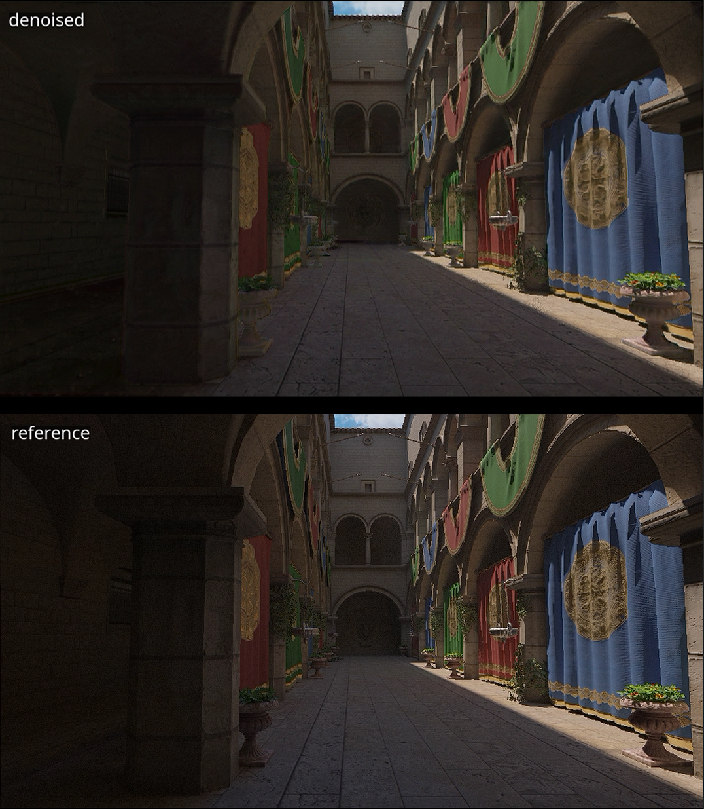
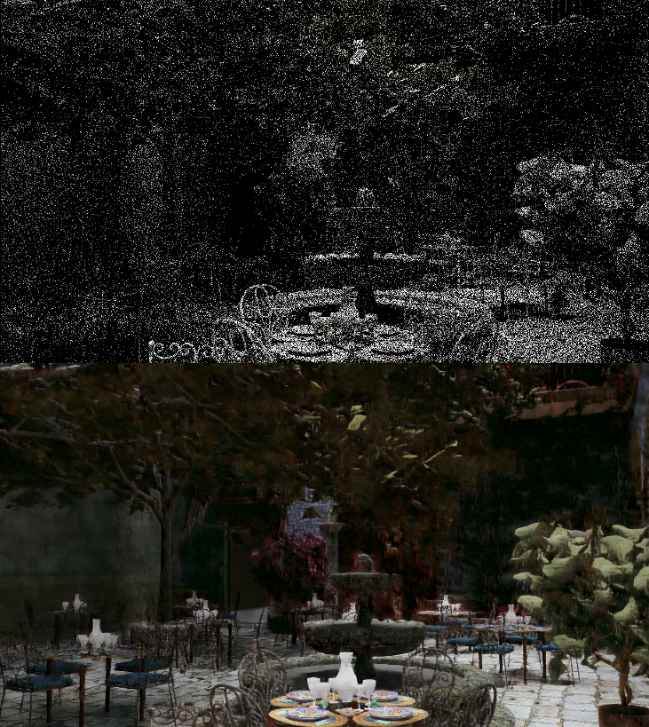

# Real-Time Neural Denoiser for Path-Traced Frames

A Temporal U-Net denoiser for 1-spp path-traced frames, conditioned on G-buffers and a
temporally reprojected history buffer. Trained on a custom Unreal Engine 5
corpus. The model is **not yet real-time**. This will be addressed in the next iteration.


---
## Temporal Build Video Demo 
[](https://youtu.be/y95izfP8LOQ)

- Side by side comparison: https://youtu.be/xnQHSMGaRvg

## Setup
- **Dataset:** custom dataset captured from Unreal Engine, 13 scenes [4 clips per scene] × 20 frames, 960×540
  - Buffers: 1-spp color, albedo, shading normal, world position, reference
    
- **Split:** held out `Sponza`
- **Hardware:**  (ROCm 10 / Radeon RX 7900 XTX, Ubuntu)
- **Training:**  epochs= 60, Adam lr=1e-4, batch 32, 256×256 random crops, 16 patches/frame
---

## Temporal Build 

Temporal reprojection resulted in **33.71 dB** compared to the spatial baseline.

### Temporal stability

**Dataset** - 13 scenes rendered in Unreal Engine 5.8, 4 clips × 20 frames each,
960×540, discontinuous clips for variation per frame rendered.

| Pass | Contents |
|---|---|
| `A_1spp` | 1 spp path-traced color (noisy input) |
| `B_2048spp` | 2048 spp path-traced color (reference) |
| `C_gbuffer` | Albedo, Normal, WorldPosition, Depth, MotionVectors |

6 bounces, path-tracer denoiser disabled, no anti-aliasing
(`r.PathTracing.FilterWidth 0.01`), fixed manual exposure.


**Input representation**: 16 channels:

| Channels | Buffer |
|---|---|
| 3 | demodulated log-space color |
| 3 | shading normal, decoded from `[0,1]` to `[-1,1]` |
| 3 | albedo |
| 3 | world position, per-scene normalised, background masked |
| 3 | warped previous-frame output |
| 1 | reprojection validity mask |

- **Albedo demodulation** - `color / (albedo + 1e-2)` on both input and target.
  Strips texture so the network only reconstructs lighting.
- **`log1p`** on color and reference. L1 in log space approximates relative error
  in linear space, so fireflies don't dominate the gradient.
- **Loss** - L1 + 0.5 × finite-difference gradient loss (the edge term counters
  the blurring L1 alone produces).


| Model | PSNR | Gain over input |
|---|---|---|
| 1-spp input | ~10 dB | - |
| **+ temporal reprojection** | **33.71 dB** | **~+24 dB** |

---

## Spatial Build 

Full-frame PSNR at 960×536, computed on remodulated, Reinhard-tonemapped output,
reduced per image before the log. The noisy input's own PSNR is reported
alongside every number

### Held-out scene (`San Miguel`)

| Model | PSNR | Gain over input |
|---|---|---|
| 1-spp input | ~10 dB | - |
| Spatial only | 28.29 dB | ~+18 dB |


## Spatial Build Video Demo 
[](https://youtu.be/3pdgesbkxd0)

- Trained on the BMFR Dataset

## Setup
- **Dataset:** BMFR (Koskela et al. 2019), 7 scenes × 60 frames, 720×1280
  - Buffers: 1-spp color, albedo, shading normal, world position, reference
  - [Dataset link](https://etsin.fairdata.fi/dataset/0ab24b68-4658-4259-9f1d-3150be898c63)
- **Split:** held out `san-miguel`
- **Hardware:**  (ROCm 10 / Radeon RX 7900 XTX, Ubuntu)
- **Training:**  epochs= 25, Adam lr=1e-4, batch 32, 256×256 random crops, 16 patches/frame
---

## Findings

### 1. Scene diversity

BMFR ships 7 scenes, but 4 are Sponza variants - effectively 3 distinct
environments. 

Replacing it with 13 distinct Unreal scenes raised held-out performance, 
despite a comparable total frame count. Diversity was the binding constraint throughout.


### 2. Motion vectors: engine-provided, convention validated empirically

The capture manifest documents the encoding:

```
dx_px = (R - 0.5) * 2 * W,  dy_px = -(G - 0.5) * 2 * H
pixel (x, y) at frame t came from (x - dx_px, y - dy_px) at frame t-1
```

Validated by warping frame n−1's reference into frame n and measuring error
against the real frame n:

| | Validity | Mean err | Median err |
|---|---|---|---|
| Unreal engine vectors | 96.1% | 0.0070 | 0.0021 |

On BMFR, which ships no motion-vector buffers, the vectors were instead derived
by projecting world position through the previous frame's view-projection matrix
from `camera_matrices.h`. Matrix convention was determined from the data rather
than assumed: column 3's upper-3 norm is exactly `1.000000` (pure rotation row →
row-vector convention), and the column-1/column-0 ratio is `1.7777780` against
16/9 = `1.7777778`, confirming the projection is baked in at 1280×720.

The Y-axis direction was settled by measurement, not reasoning:

| | Validity | Median err |
|---|---|---|
| `flip_y=True` | 98.9% | 0.0873 |
| `flip_y=False` | 98.9% | **0.0018** |

48× separation. Note validity was *identical* for both - only the error metric
could distinguish them, because the camera pans horizontally.

### 3. Disocclusion rejection

Bounds checking alone only catches pixels that left the frame. It misses pixels
whose history landed on a *different surface* - the case that causes ghosting.
Reprojecting world position and shading normal and rejecting on squared
difference (BMFR's shipped thresholds: `position_limit_squared = 0.01`,
`normal_limit_squared = 1.0`):

| | Validity | Mean err | Median err |
|---|---|---|---|
| Bounds only | 98.9% | 0.0108 | 0.0018 |
| + surface validation | 95.6% | 0.0095 | 0.0016 |

The 3.3% rejected carried disproportionate error while the median barely moved —
the test fires on genuine disocclusions rather than over-rejecting.

Validation buffers must be sampled with `INTER_NEAREST`; bilinear across a depth
discontinuity blends two surfaces into a value belonging to neither.


## Architecture and inference cost

TensorRT fp16 GPU compute time on an RTX 5060 Ti, measured with `trtexec`.
Excludes host transfers, which do not occur in-engine where G-buffers are
already in VRAM. PSNR is full-frame on the held-out scene.

| | Baseline | Optimised |
|---|---|---|
| Levels | 3 | 4 |
| Channels | (64, 128, 256) | (48, 96, 192, 384) |
| Stride-2 stem | - | yes |
| Up-conv kernel | 3×3 | 1×1 |
| Parameters | 8.00 M | 18.07 M |
| Inference resolution | 960×528 | 960×528 |
| TRT fp16 compute (960×528)  | **10.82 ms** | **2.35 ms** |
| **Held-out PSNR** | **33.71 dB** | **33.45 dB** |

**4.6× faster for 0.26 dB**, with 2.3× the parameters.

## Cross-stack inference latency

`(48, 96, 192, 384)` + stride-2 stem + 1×1 up-convs (**18.07 M parameters**),
34.5 MiB of fp16 weights (constant across resolutions).
Identical 91-node ONNX graph, identical weights, fp16 on both stacks. Batch 1,
median of 100 iterations, three independent runs per cell (spread < 1.5%).
Engines and programs pre-built per resolution; neither stack uses dynamic shapes.

| Render resolution | TensorRT 10.15<br>RTX 5060 Ti | MIGraphX 2.17<br>RX 7900 XTX | Speed-up | TRT activation | MIGraphX activation |
|---|---|---|---|---|---|
| 960×528   | 2.36 ms |  1.90 ms | 1.24× |  73.1 MB | 61.0 MB  |
| 1280×720  | 4.44 ms |  3.30 ms | 1.34× | 132.9 MB | 110.8 MB |
| 1920×1080 | 9.93 ms |  7.30 ms | 1.36× | 298.9 MB | 249.1 MB |
| 2560×1440 | 17.80 ms| 13.15 ms | 1.35× | 531.2 MB | 442.8 MB |


TensorRT measured with `--noDataTransfers`; MIGraphX programs compiled without
offload copy. Both figures are device-resident compute. MIGraphX activation read from
the `main:scratch` allocation in the compiled program.

### The 1.35× is the compute ratio, not the bandwidth ratio

| | RX 7900 XTX | RTX 5060 Ti 16GB | ratio |
|---|---|---|---|
| FP16 dense | 123 TFLOPS | 94.9 TFLOPS | 1.30× |
| Bandwidth | 960 GB/s | 448 GB/s | 2.14× |

## Next Steps (in progress)

- [ ] Further optimize model architecture to fit a real-time budget 
- [ ] Falcor integration and frame-time measurement
- [ ] FP8, INT8 quantization and inference
---

## References

- Koskela et al., *Blockwise Multi-Order Feature Regression for Real-Time Path
  Tracing Reconstruction* (BMFR), 2019
- Chaitanya et al., *Interactive Reconstruction of Monte Carlo Image Sequences
  using a Recurrent Denoising Autoencoder*, 2017
